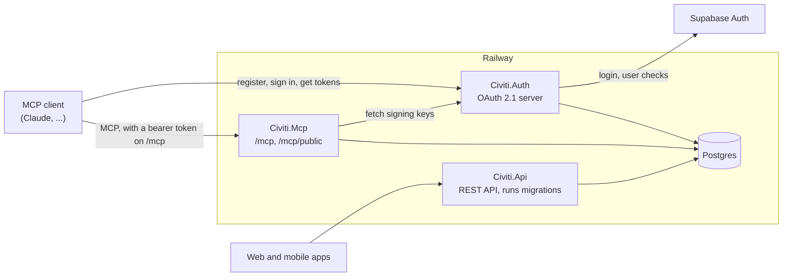

# Civiti.Mcp

The Civiti [MCP](https://modelcontextprotocol.io) server. It lets AI clients such as Claude read civic data from Civiti and, with the user's permission, act on their account.

This page is the technical reference. The setup guide for citizens lives on [civiti.ro/ghid](https://civiti.ro/ghid) and is being added there in civiti/civiti-web#84.

## Production URL

This is the one place the production URL is recorded, so link here rather than copying it.

| Endpoint | URL |
| --- | --- |
| Authenticated | `https://civiti-mcp-production.up.railway.app/mcp` |
| Anonymous | `https://civiti-mcp-production.up.railway.app/mcp/public` |

The service has no custom domain. Last verified on 2026-11-06 with an authenticated tool call through the claude.ai connector.

## Architecture



`Civiti.Mcp` doesn't call `Civiti.Api`. Both use the same `Civiti.Application` services against the same database, so moderation and business rules match the REST API. `Civiti.Api` is the only service that runs migrations. [`docs/architecture.md`](docs/architecture.md) has the reasoning.

## Endpoints

| Path | Access | Purpose |
| --- | --- | --- |
| `/mcp` | Bearer token | MCP over stateless Streamable HTTP. |
| `/mcp/public` | Anonymous | The same MCP server, without a token. |
| `/.well-known/oauth-protected-resource` | Anonymous | RFC 9728 discovery document pointing at `Civiti.Auth`. |
| `/api/health` | Anonymous | Database health check, used by Railway. |

Both MCP endpoints list all 21 tools. On `/mcp/public`, the 7 public tools work and the other 14 return `{ok: false, reason: "unauthenticated"}`. It is read-only apart from `mark_email_sent`, which bumps a public counter.

On `/mcp`, a request without a token gets `401` with a `WWW-Authenticate` header pointing at the discovery document, and that is how clients find `Civiti.Auth`.

Browser-based clients are limited by CORS to `https://claude.ai` and `https://claude.com`, on both `Civiti.Mcp` and `Civiti.Auth`.

## Rate limits

| Limit | Applies to | Enforced in |
| --- | --- | --- |
| 30 requests per minute, per source IP | `/mcp`, `/mcp/public`, the discovery document and `/api/health` | `Civiti.Mcp/Program.cs` |
| 20 requests per 24 hours, per source IP | `POST /register` | `Civiti.Auth/Program.cs` |
| 1 call per hour, per IP, per issue | `mark_email_sent` | `IssueService` |
| 10 fresh compositions per minute, per user | `generate_petition_body` | `ClaudeEnhancementService` |
| 1 comment per 10 seconds, per user, per issue | `add_comment` | `CommentService` |

- **The 30-per-minute limit is a single shared budget.** All four routes draw on the same counter, so `401` responses and discovery requests use it up too. CORS preflights don't count. It is a fixed window, not a sliding one.
- **It is per IP, not per user.** Everyone behind one IP shares the budget. Per-user limits are tracked in #118.
- **Hitting a limit returns `429` with an empty body and no `Retry-After` header**, so wait for the window to end. On `/register`, rejected requests count too.

No other `Civiti.Auth` endpoint is rate-limited. The client IP comes from `X-Forwarded-For`, read by the proxy-trust middleware in `Program.cs`.

## Authentication

`/mcp` uses OAuth 2.1 through `Civiti.Auth`, built on OpenIddict. There are no API keys. [`docs/auth-design.md`](docs/auth-design.md) has the full design.

1. **Discovery.** The client follows the `401` to the discovery document, then to `Civiti.Auth`'s OAuth metadata.
2. **Registration.** The client registers at `POST /register` (Dynamic Client Registration, in `RegisterEndpoint.cs`).
3. **Sign-in.** `/authorize` sends the user to `/Login`, for Google or email and password through Supabase. `Civiti.Auth` keeps the user's identity and discards the Supabase token.
4. **Consent.** `/Consent` shows the client, the scopes and a privacy notice. It is all-or-nothing, and the decision is stored per user and client.
5. **Tokens.** The client redeems the code at `/token` with PKCE.
6. **Calls.** `Civiti.Mcp` checks the JWT against `Civiti.Auth`'s signing keys, with no database call.
7. **Refresh.** Each refresh re-checks the user against Supabase and rotates the refresh token.

| Credential | Lifetime |
| --- | --- |
| Access token (JWT, audience `civiti-mcp`) | 15 minutes |
| Refresh token | 30 days, restarted by every refresh, so an active client stays connected |
| Sign-in session cookie | 30 minutes, not extended by activity |
| Consent cookie | 10 minutes, single use |

**Scopes.** Clients get `civiti.read`, `civiti.write` and `offline_access`. See the [tool inventory](docs/tool-inventory.md) for what each tool needs.

**Registration guardrails.**
- Redirect URIs must be loopback (`127.0.0.1` or `::1`, any port) or exactly `https://claude.ai/api/mcp/auth_callback`.
- At most 10 redirect URIs, and a client name of at most 200 characters.
- Clients are public, so PKCE is required. They show as "Unverified" on the consent screen.

**Admin scopes.** `AdminScopeFilter` strips `civiti.admin.*` unless the client is allow-listed with admin access (`claude-desktop` or `claude-code`) and the user's Supabase role is `admin`. Registered clients never qualify. No tool uses these scopes yet.

**Revocation.** Clients can call `POST /revoke`, which stops further refreshes. An access token that was already issued keeps working for up to 15 minutes, because `Civiti.Mcp` doesn't ask `Civiti.Auth` about each call. A background job also revokes sessions with admin scopes when the user stops being an admin. Users have no page to see or revoke connections yet.

## Supported clients

| Client | How it connects | Status |
| --- | --- | --- |
| claude.ai | Registers itself, using the claude.ai callback | **Verified** end to end |
| Claude Desktop | Registers itself, using the claude.ai callback | **Verified** end to end |
| Claude Code | Registers itself, using a loopback callback | Should work, untested |
| Cursor | Allow-listed, but registration rejects its redirect URI | Not expected to work |
| ChatGPT | Allow-listed, but registration rejects its redirect URI | Not expected to work |

Allow-listed entries come from `Civiti.Auth/Startup/ClientAllowListSeeder.cs`. A client only uses one if it is configured with that exact `client_id`, and the `cursor` and `chatgpt-connector` redirect URIs there are unconfirmed. Any other client that uses a loopback callback can register itself the same way as Claude Code.

## Tools

There are 21 tools: 7 public and 14 that need a token. [`docs/tool-inventory.md`](docs/tool-inventory.md) lists each one with its endpoint, scope and purpose. CI fails if that table stops matching `Civiti.Mcp/Tools/`.

Petitions are not written by a tool. They are written by the `civiti-petitions` skill, using these tools for data.

## Run it locally

You need the .NET 10 SDK and Docker. Run these from the repo root.

```bash
docker compose up -d postgres

# The key/value form matters: the postgres:// form forces SSL, which this database doesn't offer.
export DATABASE_URL='Host=localhost;Port=5433;Database=civica_dev;Username=civica;Password=civica123'
export SUPABASE_URL=https://<your-project>.supabase.co
export SUPABASE_PUBLISHABLE_KEY=<your-publishable-key>
export ASPNETCORE_ENVIRONMENT=Development
```

Then start the services in this order, each in its own terminal with those variables set. `Civiti.Api` has to go first because it creates the schema, so wait for `Database migration completed successfully` before starting the others.

```bash
PORT=8080 dotnet run --project Civiti.Api --no-launch-profile

PORT=8082 dotnet run --project Civiti.Auth --no-launch-profile

CIVITI_AUTH_ISSUER=http://localhost:8082/ \
CIVITI_MCP_PUBLIC_ORIGIN=http://localhost:8081 \
PORT=8081 dotnet run --project Civiti.Mcp --no-launch-profile
```

Check that it works:

```bash
curl -s http://localhost:8081/mcp/public \
  -H 'content-type: application/json' \
  -H 'accept: application/json, text/event-stream' \
  -d '{"jsonrpc":"2.0","id":1,"method":"tools/list"}'
```

Local runs differ from production in a few ways:

- `/mcp/public` works with placeholder Supabase values. Signing in for real needs a real Supabase project, with `http://localhost:8082/supabase-callback` allowed as a redirect URL.
- Without `OPENAI_API_KEY`, moderation is skipped.
- Without `CLAUDE_API_KEY`, `generate_petition_body` returns the fixed template.
- Without `SUPABASE_SERVICE_KEY`, refresh fails.
- Without the `OIDC_*` keys, `Civiti.Auth` uses throwaway keys, so tokens stop working when it restarts.

## Configuration

Set in the environment. [`docs/technical/configuration-guide.md`](../docs/technical/configuration-guide.md) covers generating the keys, and [`civiti-mcp-railway-setup.md`](../docs/deployment/civiti-mcp-railway-setup.md) covers the Railway service.

| Variable | Service | Required | Purpose |
| --- | --- | --- | --- |
| `DATABASE_URL` | Both | Yes | The shared Postgres database. |
| `SUPABASE_URL`, `SUPABASE_PUBLISHABLE_KEY` | Both | Yes | Supabase project. |
| `CIVITI_AUTH_ISSUER` | Civiti.Mcp | Yes | The issuer whose tokens `/mcp` accepts. |
| `CIVITI_MCP_PUBLIC_ORIGIN` | Civiti.Mcp | Yes | This service's public scheme and host. No path. |
| `OPENAI_API_KEY` | Civiti.Mcp | Outside Development | Content moderation. |
| `CLAUDE_API_KEY` | Civiti.Mcp | No | Lets `generate_petition_body` use Claude. |
| `OIDC_SIGNING_KEY`, `OIDC_ENCRYPTION_KEY` | Civiti.Auth | Outside Development | Keep tokens valid across restarts. |
| `SUPABASE_SERVICE_KEY` | Civiti.Auth | Yes, for refresh | The Supabase secret key, used to re-check users. |
| `CIVITI_AUTH_PUBLIC_ORIGIN` | Civiti.Auth | Recommended | Builds the Google callback URL. Without it, the URL comes from the request's host. |
| `SUPABASE_LOGIN_PROVIDER` | Civiti.Auth | No | OAuth provider on `/Login`. Defaults to `google`. |

`Civiti.Mcp` won't start without its required variables. `Civiti.Auth` won't start without the database, Supabase URL and publishable key, or outside Development without valid `OIDC_*` keys. It does start without `SUPABASE_SERVICE_KEY`, logging only a warning.

## Operations

**Deploys don't disconnect clients.** `Civiti.Auth` loads its signing and encryption keys from `OIDC_SIGNING_KEY` and `OIDC_ENCRYPTION_KEY`, so tokens survive a restart. Before #166 it generated new keys on every start, which forced every client to reconnect after every deploy.

To check a deploy, look for `OpenIddict signing and encryption keys loaded from configuration.` in the `Civiti-Auth` logs, and confirm the `kid` at `/.well-known/jwks` hasn't changed.

**Changing either key signs everyone out once.** Only one key of each kind is loaded, so there is no overlap period. If a key is missing or invalid, `Civiti.Auth` refuses to start and the failed healthcheck leaves the previous deployment serving.

**The consent cookie must stay `SameSite=Lax`.** Consent flows start on another site, such as claude.ai, and browsers judge `SameSite` by where the navigation started, so a `Strict` cookie never reaches `/Consent`. #161 fixed that regression, and [`docs/auth-design.md` §7](docs/auth-design.md#consent-cookie) explains why `Lax` is still safe.

## Troubleshooting

What a client or user sees, and what it means:

| Symptom | Cause | What to do |
| --- | --- | --- |
| `429` with an empty body from `Civiti.Mcp` | Over the 30-per-minute limit for that IP | Wait for the next minute. |
| `429` from `/register` | Over 20 requests in 24 hours for that IP | Wait, or stop re-adding the connector. |
| `Consent context missing or expired. Restart the OAuth flow.` (`400`) | The consent page took over 10 minutes, or the form was already submitted | Connect again. If it happens straight away, check the cookie is still `SameSite=Lax`. |
| `This consent form is stale. Restart the OAuth flow.` (`400`) | A second sign-in started in another tab | Connect again, in one tab. |
| `no_civiti_account` (`403`) after sign-in | The account has no Civiti profile | Sign up on civiti.ro first. |
| `invalid_redirect_uri` from `/register` | The client's callback isn't loopback or the claude.ai callback | See [Supported clients](#supported-clients). |
| `invalid_grant`, "The upstream user no longer exists." on every refresh, so the client signs in again every 15 minutes | `SUPABASE_SERVICE_KEY` is missing on `Civiti-Auth`, or the user really was deleted | Check the startup log for `SUPABASE_SERVICE_KEY is not set`, then set the key. Without it, the admin session sweep is skipped too. |
| `invalid_grant`, "Could not revalidate the upstream user." | Supabase was unreachable, and refresh fails closed | Sign in again once Supabase recovers. |
| `invalid_grant` with `ID2004` right after a deploy | An `OIDC_*` key changed | Everyone signs in once. If it wasn't deliberate, restore the old key. |
| Tool returns `reason: "unauthenticated"` | The client is on `/mcp/public` | Use `/mcp` and sign in. |
| Tool returns `reason: "missing_scope"` | The token lacks `civiti.read` or `civiti.write` | Reconnect and approve the scope. |
| Tool returns `reason: "user_profile_missing"` | The account hasn't finished signup | Finish signup in the app. |
| Tool returns a generic error | The service refused the call, for example a comment rate limit | Check the `Civiti-MCP` logs. |

[`docs/tool-inventory.md` §2.3](docs/tool-inventory.md#23-errors-moderation-and-untrusted-content) lists every structured tool error.

## Documents

| Doc | Purpose |
| --- | --- |
| [`docs/tool-inventory.md`](docs/tool-inventory.md) | Every tool, plus designs that aren't built yet. |
| [`docs/auth-design.md`](docs/auth-design.md) | The full auth design and its decision log. |
| [`docs/connecting-civiti-to-claude.md`](docs/connecting-civiti-to-claude.md) | Short developer summary of connecting a client. |
| [`docs/architecture.md`](docs/architecture.md) | The original design record: service boundaries, transport, deployment. |
| [`../docs/security/mcp-prompt-injection-review-2026-05-05.md`](../docs/security/mcp-prompt-injection-review-2026-05-05.md) | Prompt-injection review of the tool surface. |
